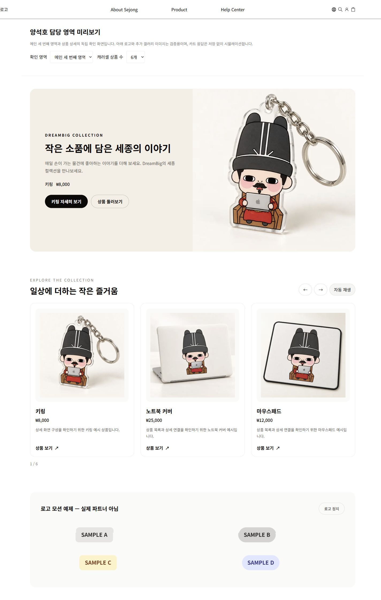

# 메인 세 번째 영역

양석호 담당 구현이다. 상품 데이터로 배너와 캐러셀을 구성하고, 전달받은 파트너 로고를 두 행으로 이동시킨다. Next.js, React, Tailwind를 사용하는 앱 내부 컴포넌트이며 별도 패키지는 아니다.

## 연결

메인 담당자가 배치할 위치에서 다음 컴포넌트를 렌더링한다. 이번 작업은 공용 `app/page.tsx`, 헤더, 다른 담당 영역을 변경하지 않았다.

```tsx
import HomeThirdSection from "@/components/main/HomeThirdSection";

<HomeThirdSection />
```

기본 데이터는 `util/data/products.ts`와 `util/data/home.ts`에서 가져온다. `products`, `banners`, `items`, `logos`, `logoTitle` props로 교체할 수 있다. 상품 ID가 없는 배너와 카드는 생략한다. 기본 파트너 로고는 빈 배열이므로 실제 파트너 영역은 노출되지 않는다.

```tsx
<HomeThirdSection
  products={products}
  banners={banners}
  items={carouselItems}
  logos={approvedPartnerLogos}
/>
```

## 구성과 입력

| 컴포넌트 | 입력과 동작 |
| --- | --- |
| ProductBanner | `banner`, `product`. 이미지와 문구, actions의 링크를 표시한다. 모바일 이미지가 없으면 데스크톱 이미지를 사용한다. |
| ProductCarousel | `entries: { item: CarouselItem; product: Product }[]`, 선택 `title`, `autoplayMs`(기본 6000ms, 최소 1000ms). |
| ProductCarouselCard | `entry`, 선택 `tabIndex`. 상품명과 가격은 공통 Product를 사용하며 상품 ID가 포함된 상세 링크로 이동한다. hoverImage는 선택 값이다. |
| PartnerLogoMarquee | `logos`, 선택 `title`, `rowDurationSeconds`(기본 28/36초, 최소 5초). 빈 배열이면 영역을 생략한다. |

캐러셀은 컨테이너 너비 600px 미만에서 1개, 600px 이상에서 2개, 960px 이상에서 3개를 표시한다. 상품이 한 화면에 모두 들어오면 이동과 자동 재생을 끈다. 카드 이동은 폭과 24px 간격을 함께 계산한다.

이전/다음, 40px 이상의 수평 스와이프, 자동 재생을 지원한다. 세로 이동이 큰 제스처는 스와이프로 처리하지 않는다. 전환 중 중복 이동을 막고 스와이프 뒤 링크 클릭을 억제한다. 끝의 복제 구간에 도달하면 전환 없이 실제 위치로 복귀한다. 현재 보이는 카드만 포커스와 접근성 트리에 포함한다.

hover, 포커스, 포인터 유지, 사용자의 정지 선택, 모션 감소 설정은 자동 이동보다 우선한다. 사용자 정지 선택은 화면 크기가 바뀌어도 유지한다. 문서가 숨겨진 동안에는 자동 이동하지 않는다. 타이머, ResizeObserver, animation frame은 unmount 시 정리한다.

로고는 같은 방향으로 서로 다른 속도로 이동한다. hover/focus/포인터 유지 또는 정지 버튼으로 멈춘다. 복제 로고는 중복 낭독과 탭 정지에서 제외한다. 모션 감소 설정에서는 애니메이션 없이 정적인 목록을 표시한다.

현재 프로젝트의 CSS 로더는 CSS module 클래스 매핑을 제공하지 않아 `homeThird.css`에 `ysh-` 접두사를 사용했다. 공용 설정과 전역 CSS 파일을 바꾸지 않는다.

## 실행과 검증

```sh
npm ci
npm run build
npm run start -- --port 3001
npx tsx --test components/main/carouselModel.test.ts components/product-detail/reviewModel.test.ts
```

`/preview/ysh`는 담당 영역의 독립 미리보기다. 상품 수 0/1/3/6개를 선택하고, 상세 검증 화면으로 전환할 수 있다. 로고의 SAMPLE 표시는 실제 파트너가 아닌 동작 검증용이다.

2026-10-15 검증: 프로덕션 빌드/TypeScript 통과, 담당 코드 ESLint 오류/경고 없음, 순수 로직 테스트 6개 통과. 브라우저에서 상품 수별 이동 유무, 양 끝 반복, 375px 폭의 포인터 스와이프와 링크 억제, 자동 이동, 로고 28/36초 CSS 적용과 정지를 확인했다. 375/768/1440px에서 담당 main 콘텐츠의 가로 넘침이 없음을 확인했다.

모바일 실제 터치 장치와 OS 모션 감소 설정 변경은 별도 확인 대상이다. 375px에서 공통 헤더로 인한 전체 문서 가로 넘침은 남아 있으며, 다른 담당 파일 수정 금지 범위에 따라 유지했다. 실제 메인 배치와 카트 저장소, 배포 환경 검증은 완료 범위에 포함하지 않는다.


