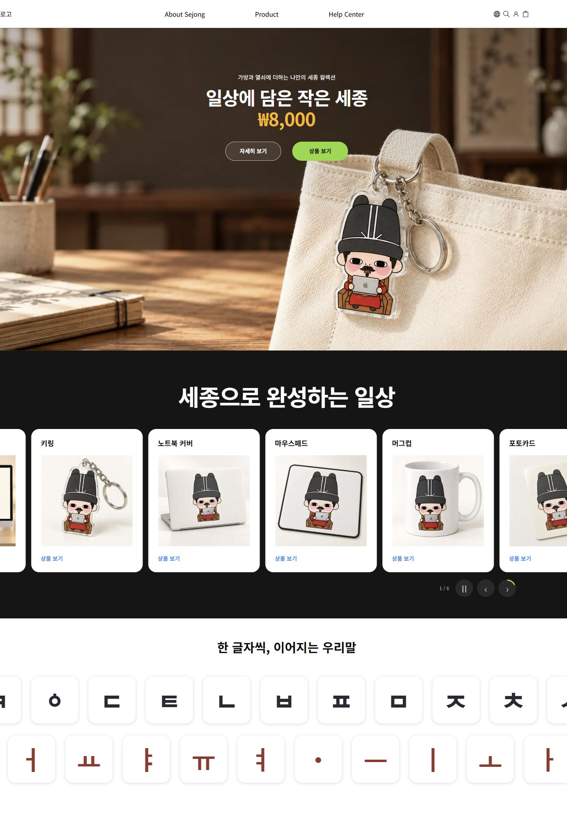
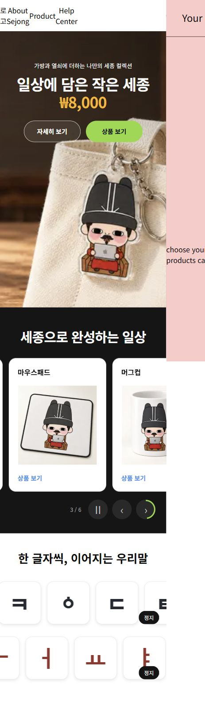
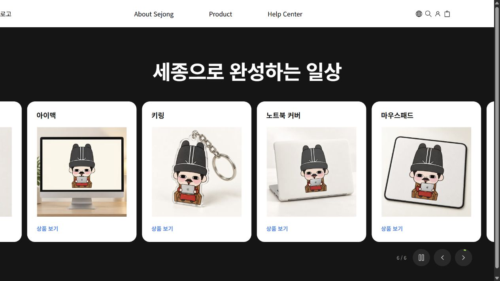

# 메인 세 번째 영역

양석호 담당의 앱 내부 컴포넌트다. XbotGo의 전폭 배너, 어두운 상품 캐러셀, 흰색 두 행 모션 구조를 프로젝트 상품과 훈민정음 글자로 구성했다. 공용 메인, 헤더와 다른 담당 영역은 이번 변경에 포함하지 않는다.

## 연결과 미리보기

```tsx
import HomeThirdSection from "@/components/main/HomeThirdSection";
<HomeThirdSection />
```

`products`, `banners`, `items`를 선택 전달한다. 기본 데이터는 `util/data/products.ts`, `home.ts`, `hunmin.ts`다. 없는 상품 ID의 배너/카드는 생략한다. 실제 `app/page.tsx` 삽입은 메인 담당자의 연결 작업이다.

| 주소 | 확인 대상 |
| --- | --- |
| /preview/ysh | 전체 링크, 상품 수와 상세/카트 응답 시뮬레이션 |
| /preview/ysh/main | 담당 메인 3개 영역 |
| /preview/ysh/banner | 전폭 배너와 상세 CTA |
| /preview/ysh/carousel | 상품 캐러셀 |
| /preview/ysh/hunmin | 자음/모음 독립 모션 |
| /product/101 ~ /product/106 | 여섯 상품 상세 |

## 컴포넌트와 동작

- `ProductBanner`: banner/product 입력, 16:9 전폭 사진, 중앙 제목/가격/두 CTA. 모바일 최소 높이 620px.
- `ProductCarousel`: entries(item/product), 선택 title/autoplayMs. 기본 6초 이동. 카드 280×360px, 간격 14px. 600px 미만에서는 220×300px. 양 끝 복제 구간으로 반복하며 보이는 카드만 키보드/접근성 트리에 포함한다.
- `ProductCarouselCard`: 기본 상품 사진/제목/상세 링크. 별도 hover 사진이 있는 상품에만 전환 사진을 표시한다.
- `ProductCarouselControls`: 기존 공통 Button과 Lucide의 ChevronLeft/ChevronRight/Pause/Play를 사용한다. 진행 원은 별도 SVG/CSS로 유지한다.
- `HunminJeongeumMarquee`: 제목과 두 행을 조합한다.
- `HunminConsonantRow`, `HunminVowelRow`: 각각 48초/34초로 같은 방향으로 이동한다. 공통 `HunminLetterRow`를 사용하되 정지 상태는 각 인스턴스에 둔다.

상품 캐러셀은 마우스를 올려도 자동 이동을 계속한다. focus/포인터 유지/수동 정지/모션 감소 설정에서는 멈춘다. 수평 스와이프 뒤 링크 클릭을 억제한다. 수동 정지는 리사이즈 후에도 유지하고 숨겨진 문서에서는 자동 이동하지 않는다. 타이머, animation frame, ResizeObserver는 해제 시 정리한다. 상품 0개에서는 캐러셀을 생략하고 1개에서는 제어 버튼과 자동 이동을 생략한다.

글자 행은 **해당 행의 hover/focus만 정지**하며 수동 정지 버튼도 독립적이다. 반복 복제 목록에는 aria-hidden을 적용한다. 모션 감소 설정에서는 원본 글자 목록을 정적으로 표시한다. 기존 `PartnerLogoMarquee`는 현재 조합에서 사용하지 않는다.

이미지는 상품별 용도를 `util/data/productMedia.ts`에 분리했다. 갤러리, 상세 연출, hover, 후기 사진을 서로 다른 파일로 배정하며 부족한 hover 사진을 반복 사진으로 채우지 않는다. 배너 전용 새 이미지의 제작 근거는 [에셋 기록](../../docs/ysh/asset-notes.md)에 있다.

## 검증

2026-10-15 로컬 프로덕션 빌드/TypeScript, 담당 ESLint, 순수 로직 테스트 6개 통과. 브라우저에서 고정 카드 크기/간격, 자동 이동, 양 끝 반복, 수동 정지, 0/1개 상태와 상세 링크를 확인했다. 자음 행 hover 시 모음 행은 계속 이동하고 반대 동작도 확인했다. 메인/상세 담당 콘텐츠의 375/768/1440px 가로 넘침이 없다.

```sh
npm ci
npm run build
npm run start -- --port 3001
npx tsx --test components/main/carouselModel.test.ts components/product-detail/reviewModel.test.ts
```

실제 터치 장치와 OS 모션 감소 설정 변경은 검증하지 않았다. 375px의 공통 헤더 가로 넘침은 다른 담당 범위라 남아 있다. 실제 메인 삽입, DB/카트 저장소, 배포 검증은 미완료다.




공통 버튼 적용 후 빌드/TypeScript, 변경 파일 ESLint, 캐러셀 테스트 3개를 통과했다. 브라우저에서 hover 중 위치 변경, 다음/정지/재생과 20px Lucide 아이콘을 확인했다. 훈민정음은 각 행의 hover 시 해당 행만 정지한다.


