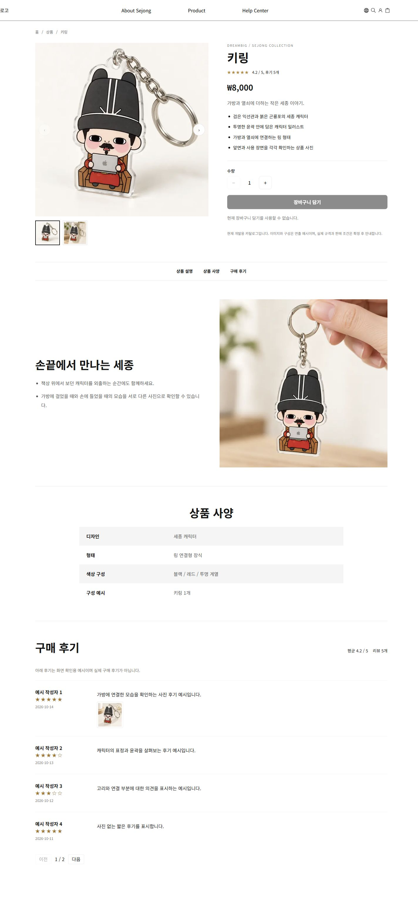
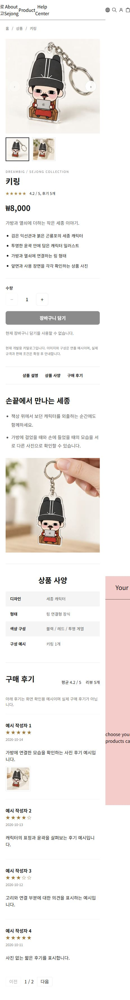

# 상품 상세 컴포넌트

`/product/[id]`는 URL ID로 `getProductDetailData`를 조회하고 `ProductDetailPage`에 data/template을 전달한다. XbotGo 상품 상세의 정보 순서를 참고해 개요, 상세 설명, 사양, 리뷰를 배치했다. 데스크톱 개요는 왼쪽 갤러리와 오른쪽 구매 정보, 모바일은 한 열이다.

## 화면 구조와 입력

| 구성 | 입력과 기능 |
| --- | --- |
| ProductGallery | images, selectedImageId, onImageSelect, fit. 썸네일 ul/li, 이전/다음, 확대 dialog |
| ProductInfo | product, currency, summary, highlights, reviews. 제목/평점/가격/설명과 핵심 특징 ul/li |
| OverviewSection | data, galleryFit, 선택 onAddToCart. 갤러리, 수량/담기, 예시 판매 조건 안내 |
| ProductFeatures | features, title. 별도 연출 사진과 설명 ul/li |
| ProductSpecifications | specifications, title. 항목 이름/값을 ul/li로 표시 |
| ReviewsSection | reviews, title, pageSize. 전체 평균/개수, 페이지당 4개, 사진 확대 |

상세 목차는 상품 설명, 사양, 구매 후기 위치로 이동한다. 상품 ID가 바뀌면 개요와 리뷰를 다시 생성해 이미지, 수량과 리뷰 페이지를 초기화한다. 빈 갤러리/리뷰 안내, 빈 사양 생략, 수량 최소 1, 모달 Esc/배경/닫기 버튼과 포커스/스크롤 복구를 지원한다.

## 로컬 데이터와 추후 DB 연결

- `util/data/products.ts`: 팀 공통 상품 ID, 이름, 가격, 통화와 대표 사진 원본.
- `util/data/productMedia.ts`: 상품별 갤러리 2장, 별도 설명 사진 1장, 선택 hover/후기 사진. 각 용도에 다른 파일을 배정한다.
- `util/data/productDetails.ts`: 101~106의 요약, 핵심 특징 4개, 설명 블록, 사양 4개와 안내문.
- `util/data/reviews.ts`: 상품별 예시 후기 5개. 평균 4.2이며 실제 구매 후기가 아님을 화면에 명시한다.
- `util/data/detailTemplates.ts`: overview → features → specifications → reviews 표시 순서.
- `util/types/detail.ts`: 위 입력의 타입 계약.
- `util/product.ts`: 원본/설정/리뷰를 ID로 조합하는 조회 경계.

DB와 API는 아직 없다. 추후 서버 조회 결과를 `ProductDetailData`로 변환해 기존 화면에 전달하면 된다. URL의 상품 ID를 조회 기준으로 유지하며, 없는 ID를 다른 상품으로 대체하지 않는다. 원격 이미지 URL을 사용하면 Next.js의 허용 이미지 호스트 설정을 실제 백엔드 주소에 맞춰 연결해야 한다. 현재 크기/소재/배송 등 확인되지 않은 판매 사양은 사실처럼 추가하지 않았다.

## 카트 연결

`cartConnection.ts`의 AddToCartHandler 계약은 `{ productId, quantity }`를 받아 `{ ok: true }` 또는 `{ ok: false, message }`를 동기/비동기로 반환한다. 성공 결과 확인 후에만 성공 안내를 표시하고 실패/예외는 오류 안내로 처리한다. 요청 중 버튼과 수량 변경을 잠그고 중복 요청을 막는다. 콜백 미연결 시 담기 버튼은 비활성화한다.

Client 연결부에서 실제 팀 카트 함수를 변환해 `ProductDetailPage`의 onAddToCart에 전달한다. `/preview/ysh`의 성공/실패/예외 콜백은 저장하지 않는 시뮬레이션이다. 실제 카트 항목 병합/저장/헤더 개수/패널 열기는 카트 담당자의 연결 작업이다.

## 확인 순서와 검증

1. `/preview/ysh`의 상품별 상세 링크로 여섯 상품을 비교한다.
2. 갤러리 썸네일/화살표, 사진 확대와 Esc 닫기를 확인한다.
3. 핵심 특징과 사양 목록, 상세 목차, 리뷰 다음 페이지를 확인한다.
4. 미리보기의 상세 모드에서 상품/리뷰 수/빈 갤러리/카트 응답을 변경한다.

2026-10-15 프로덕션 빌드/TypeScript, 담당 ESLint와 순수 로직 테스트 6개 통과. 여섯 상품 직접 접속에서 제목, 핵심 특징 4개, 사양 4개와 설명/후기 영역을 확인했다. 이미지 변경/확대/Esc, 리뷰 다음 페이지와 375/768/1440px 담당 영역 가로 넘침 없음도 확인했다. 기존 검증은 잘못된 ID 404, 리뷰 0/4/5개 경계, 카트 시뮬레이션 성공/실패/예외와 중복 방지를 포함한다.

공통 헤더의 모바일 넘침, 실제 카트/DB와 배포 환경 검증은 남아 있다.

