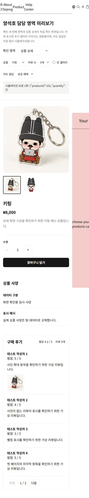

# 상품 상세 컴포넌트

`/product/[id]`는 URL ID로 공통 상품과 상세 설정을 조회하고 `ProductDetailPage`에 `data`, `template`을 전달한다. 템플릿의 overview, specifications, reviews 순서대로 화면을 만든다. 상품 ID가 바뀌면 개요와 리뷰 컴포넌트를 다시 생성해 선택 이미지, 수량과 리뷰 페이지를 초기화한다.

## 제공 기능

- 이미지 선택과 빈 갤러리 안내. 템플릿 `galleryFit`의 contain/cover를 적용한다.
- 수량 최소 1, 안전한 정수 상한, 요청 중 수량/담기 버튼 잠금.
- 빈 사양 생략, 사양 목록과 반응형 배치.
- 전체 리뷰의 평균/개수, 페이지 크기 기본 4, 빈 리뷰와 줄어든 페이지 경계 보정.
- 네이티브 dialog 기반 사진 확대, 닫기 버튼/배경/Esc, 스크롤과 포커스 복구.

## 팀 카트 연결

`cartConnection.ts`는 상세에서 소비할 연결 계약이다. 팀 카트 저장소 자체를 구현하거나 공통 카트 타입을 바꾸지 않았다. Client 연결부에서 실제 팀 함수의 입력/결과를 변환한 뒤 `ProductDetailPage`의 `onAddToCart`로 전달한다.

```tsx
"use client";

import ProductDetailPage from "@/components/product-detail/ProductDetailPage";
import type { AddToCartHandler } from "@/components/product-detail/cartConnection";

// 실제 카트 함수의 확인된 결과를 아래 형태로 변환한다.
// type AddToCartHandler = (request: { productId: number; quantity: number }) =>
//   { ok: true } | { ok: false; message: string } | Promise<...>;

// <ProductDetailPage data={data} template={template} onAddToCart={handleAddToCart} />
```

`quantity`는 추가할 수량이다. 콜백은 동기/비동기 모두 지원한다. 성공 결과가 확인된 경우에만 성공 메시지를 표시하고, 실패 결과 또는 예외는 오류 메시지로 처리한다. 처리 중 중복 요청을 ref로 차단한다. 콜백이 없으면 담기 버튼을 비활성화하고 사용 불가 안내를 표시한다. 서버 라우트에서 일반 함수를 Client 컴포넌트에 넘기지 않는다.

실제 카트 항목 병합, 저장/복원, 헤더 개수와 카트 패널 열기는 카트 담당자의 연결 작업이다. `/preview/ysh`의 성공/실패/예외 선택은 테스트용 콜백이며 실제 카트 연동 완료를 뜻하지 않는다.

## 검증과 데이터

현재 실제 상세 데이터에는 상품별 대표 이미지 한 장을 사용한다. 추가 사진이 들어오면 `util/data/productDetails.ts`의 images 배열에 등록한다. 독립 미리보기는 캐릭터 일러스트를 두 번째 이미지로 붙여 선택 동작을 확인한다. 이 이미지를 실제 상품 추가 사진으로 등록하지 않는다.

리뷰 0/4/5개, 평균 4.2, 이미지 선택, 상품 변경 시 초기화, 사양 유무, 모달 닫기 세 방식과 포커스/스크롤 복구, 카트 요청 중 잠금과 성공/실패/예외 응답을 브라우저에서 확인했다. 담당 상세 영역은 375/768/1440px에서 가로 넘침이 없고 넓은 화면에서는 상단이 2열이다. 공통 헤더의 모바일 가로 넘침은 이 작업의 수정 범위 밖이다.

`reviewModel.test.ts`는 0/4/5개와 잘못된 페이지 설정, 데이터 감소, 전체 리뷰 기준 집계를 검증한다.

브라우저에서 `/product/101`, `/product/102` 직접 접속과 새로고침을 확인했다. ID `999`, `abc`, `0`, `-1`, `1.5`는 404 안내 화면을 표시했다. 카트 성공 예제의 더블 클릭은 요청 한 번만 발생했다. 이 검증은 로컬 프로덕션 서버 기준이다.



```sh
npx tsx --test components/main/carouselModel.test.ts components/product-detail/reviewModel.test.ts
```

## 시연 순서

1. `/preview/ysh` 메인 영역의 배너와 캐러셀에서 상품 상세로 이동한다.
2. 상세 `/product/101`과 `/product/102`를 비교한다. 같은 템플릿으로 상품 내용이 바뀐다.
3. 미리보기의 상품 상세 모드에서 이미지, 수량, 리뷰와 확대 모달을 조작한다.
4. 카트 응답을 성공/실패/예외로 바꿔 전달된 상품 ID와 수량, 처리 중 잠금을 확인한다. 실제 카트 저장은 없음을 구분한다.
5. 메인 미리보기에서 카드 수와 화면 폭을 바꿔 반복과 빈 상태, 로고 정지를 확인한다.
