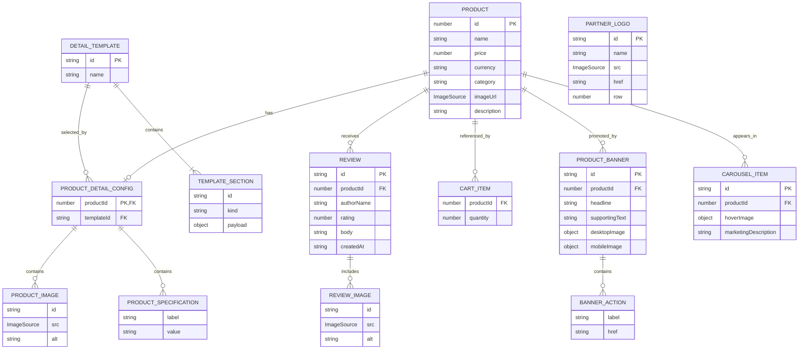

# DreamBig 공통 데이터와 전체 ERD

데이터 관리 담당은 양석호다. 메인, 상품 목록, 상품 상세, 장바구니가 같은 상품 ID와 상품 원본을 사용한다. 이 문서는 기존 정적 프론트엔드 데이터 관계를 설명한다. 새 Supabase 회원, 상품, 카트, 주문, 결제, 관리자 API는 [담당별 사용법](./api/README.md)을 참고한다. 아래 정적 데이터와 기존 화면을 자동으로 DB로 전환한 것은 아니다.

`util` 아래에 타입, 실제 데이터, 조회 함수를 나눠 둔다. 공통 UI 클래스 함수인 `lib/utils.ts`와 기존 `shared/asset` 이미지는 그대로 사용한다.

## 담당별로 확인할 파일

| 확인 담당 | 확인할 데이터와 코드 | 사용하는 내용 |
| --- | --- | --- |
| 양석호 / 데이터 관리 | `data/` 전체, `types/` 전체, `product.ts` | 상품 ID와 원본 데이터, 참조 관계 관리 |
| 홍정기 / 상품 목록 | `data/products.ts`, `types/product.ts` | 상품명, 가격, 통화, 대표 이미지, 상품 상세 링크 |
| 홍정기 / 메인 첫 영역 | `data/products.ts` | 상품을 노출할 때 같은 원본 사용 |
| 원정린 / 공통 헤더와 두 번째 영역 | `types/product.ts`, `types/cart.ts` | 상품을 노출할 때의 공통 타입 참고. 헤더 카트 개수는 카트 저장소와 연결 |
| 양석호 / 상품 상세 | `data/productDetails.ts`, `data/reviews.ts`, `data/detailTemplates.ts`, `types/detail.ts`, `product.ts` | 상품 ID로 상세 정보 조회, 섹션 구성, 사양과 리뷰 |
| 양석호 / 메인 세 번째 영역 | `data/home.ts`, `types/home.ts`, `data/products.ts` | 배너, 캐러셀, 파트너 로고 |
| 장바구니 담당자 / 이름 확인 필요 | `types/cart.ts`, `data/products.ts` | 상품 ID와 수량, 공통 상품 조회. 저장소 구현은 별도 |

파일 주석의 관리 담당과 사용 담당은 구분한다. 원정린 담당 화면의 문구나 내비게이션 구조를 이 데이터 작업에서 변경하지 않는다.

## 파일 구조

```text
util/
  types/
    product.ts          공통 상품, 통화, 이미지 타입
    detail.ts           상세 설정, 사양, 리뷰, 템플릿, 화면 전달 타입
    home.ts             배너, 버튼 링크, 캐러셀, 파트너 로고 타입
    cart.ts             카트 항목과 담기 요청 타입
  data/
    products.ts         상품 정보 원본 6개
    productDetails.ts   상품별 상세 설정
    reviews.ts          상품 ID에 연결한 리뷰
    detailTemplates.ts  섹션 종류와 표시 순서
    home.ts             메인 노출 데이터
  product.ts            상품 조회와 상세 데이터 조합
```

## 전체 관계



박스는 데이터의 역할을 나타내며, 별도 DB 테이블을 모두 만들라는 뜻은 아니다. 상품 이미지와 사양은 상세 설정 안의 배열, 리뷰 이미지는 리뷰 안의 배열, 섹션은 템플릿 안의 배열이다. 부모 관계는 중첩 구조로 표현하므로 각 항목에 외래 키를 중복 저장하지 않는다. 이미지와 섹션 ID는 부모 배열 안에서 유일해야 한다.

상품당 상세 설정은 최대 하나다. 현재 6개 상품에는 모두 설정이 있다. `CartItem`은 사용자별 카트의 항목 계약이며 현재 카트 저장소는 구현하지 않았다. `PartnerLogo`는 상품과 독립되어 있다.

## 데이터별 의미와 규칙

### Product / 공통 상품

목록, 메인, 상세, 카트가 함께 사용하는 상품 원본이다. 상품명과 가격을 다른 파일에 다시 적지 않는다. `id`는 배열 인덱스가 아니며 정렬해도 바뀌지 않는다.

| ID | 상품 | 가격 | 통화 |
| --- | --- | --- | --- |
| 101 | 키링 | 8000 | KRW |
| 102 | 머그컵 | 15000 | KRW |
| 103 | 노트북 커버 | 25000 | KRW |
| 104 | 마우스패드 | 12000 | KRW |
| 105 | 포토카드 | 3000 | KRW |
| 106 | 월페이퍼 | 2000 | KRW |

기존 101/102와 여섯 상품의 이름, 가격을 유지했다. 103~106은 이번 데이터 통합에서 부여했다. `price`는 표시 단위 숫자다. KRW는 원, USD는 달러, JPY는 엔이며 `Intl.NumberFormat`은 환율 변환을 하지 않는다. 한 카트에서 서로 다른 통화를 숫자로 그대로 합산하지 않는다. 현재 카탈로그는 모두 KRW다.

이미지는 `string | StaticImageData`를 허용한다. 현재 상품은 `shared/asset`의 기존 PNG import를 사용한다. 네트워크 API로 전환할 때는 URL 문자열 데이터와 화면 타입 사이의 변환을 연결부에서 처리한다.

### ProductDetailConfig / 상품 상세 전용 정보

`productId`로 공통 상품과 연결하고 `templateId`로 화면 구조를 선택한다. `images`에는 추가 갤러리 사진을, `specifications`에는 label/value 형태의 표시용 사양을 넣는다. 사양 값에 단위를 포함하며 비교나 계산용 숫자로 사용하지 않는다.

갤러리 배열이 비어 있으면 조회 함수가 공통 상품의 대표 이미지 한 장을 사용한다. 사진을 등록하면 등록한 배열이 우선한다. 상품이나 상세 설정이 없으면 조회 결과는 `undefined`이며 라우트에서 `notFound()`로 처리한다. 현재 빈 사양의 화면 생략은 UI에서 구현할 항목이다.

### Review / 리뷰

`productId`로 상품을 참조한다. `rating`은 1~5, `createdAt`은 ISO 8601 문자열, `images`는 리뷰 사진 목록이다. 현재 키링 리뷰 5개는 개발용 가상 리뷰이며 머그컵을 포함한 다른 상품의 리뷰는 없다. 사진 확대용 이미지도 실제 구매자가 등록한 사진이 아니다.

리뷰 평균과 개수는 조회한 리뷰에서 계산한다. 리뷰 작성자 표시명만 사용하고 있으며, 회원 데이터베이스와 연결한 상태는 아니다.

### DetailTemplate / 화면 구성

현재 기본 순서는 overview → specifications → reviews다. `kind`는 렌더링할 컴포넌트 종류이며 `id`는 React key다. `payload`는 galleryFit, 제목, pageSize와 같은 표시 설정이다. 상품의 이름, 가격, 설명을 넣는 곳이 아니다. 리뷰 기본 페이지 크기는 4다.

### ProductDetailData / 화면에 전달할 조합 결과

별도의 원본 데이터나 DB 테이블이 아니다. `getProductDetailData(productId)`가 Product, 상세 설정, 리뷰를 조합해 만든다. 기존 컴포넌트 계약을 유지하기 위해 `currency`를 포함하지만 값은 항상 `product.currency`에서 가져온다. 템플릿 객체는 라우트에서 조회한 뒤 별도 `template` props로 전달한다.

### 메인 배너, 캐러셀, 로고

배너와 캐러셀은 `productId`로 상품을 참조한다. 배너 문구와 PC/모바일 이미지는 배너 전용이며, 캐러셀은 노출 순서와 선택적인 hover 이미지/소개만 가진다. 캐러셀 여섯 항목은 기존 상품 목록 순서를 유지한다.

파트너 로고는 상품과 독립이며 `row`는 0 또는 1이다. 애니메이션용 복제는 렌더링에서 한다. 현재 배너와 로고는 빈 배열로 두었으며 노출 문구, 링크, 로고 등록은 메인 구현 때 진행한다. 첫 번째와 두 번째 영역의 데이터 요구사항은 아직 정의하지 않았으므로 임의로 필드를 만들지 않았다.

### 장바구니 데이터 계약

`CartItem`은 productId와 quantity를 가진다. 상품명과 가격은 공통 상품에서 조회한다. `AddToCartRequest.quantity`는 추가할 수량이며 1 이상의 정수여야 한다. 옵션 없는 현재 범위에서는 카트 안에 같은 productId의 항목을 하나로 관리하는 계약이다.

담기 함수와 반환값, 중복 담기 시 수량 병합, localStorage 저장/복원은 카트 담당자와 연결할 구현 항목이다. 사용자의 카트 내용을 공통 정적 데이터 파일에 저장하지 않는다. 가격 확정이 필요한 주문 단계는 이 카트 표시 계약과 별개다.

## 사용하는 방법

홍정기 / 상품 목록:

```tsx
import { products } from "@/util/data/products";

// 카드에는 product를 전달하고 상세 주소는 `/product/${product.id}`로 만든다.
const productList = products;
```

양석호 / 상품 상세:

```tsx
import { getProductDetailData } from "@/util/product";
import { detailTemplates } from "@/util/data/detailTemplates";

const data = getProductDetailData(101);
if (data) {
  const template = detailTemplates.find((item) => item.id === data.templateId);
  // 라우트는 data와 template의 존재를 확인한 뒤 상세 컴포넌트로 전달한다.
}
```

메인 또는 장바구니 담당자 / 공통 상품 조회:

```ts
import { getProductById } from "@/util/product";
import type { CartItem } from "@/util/types/cart";

const item: CartItem = { productId: 101, quantity: 2 };
const product = getProductById(item.productId);
// product가 없으면 삭제되거나 잘못된 상품 ID를 처리한다.
const lineTotal = product ? product.price * item.quantity : undefined;
```

조회 함수는 동기 함수이며 입력 배열을 수정하지 않는다. `readonly`는 TypeScript에서 직접 수정을 막는 계약이고 런타임 deep freeze가 아니다. 선택 이미지, 입력 중인 수량, 현재 리뷰 페이지, 열린 모달은 UI 상태로 관리한다.

## 이전 경로 정리

- `shared/mocks/mockMerch.ts`: 여섯 상품을 `data/products.ts`로 통합하고 삭제했다.
- `shared/product-detail/detailData.ts`: 타입은 `types/detail.ts`, 상품은 `data/products.ts`, 상세 설정과 리뷰는 각 데이터 파일로 나눴다.
- `shared/product-detail/templates.ts`: 타입은 `types/detail.ts`, 템플릿 값은 `data/detailTemplates.ts`로 옮겼다.
- 비어 있던 `shared/types/product.ts`: 삭제하고 `types/product.ts`에 공통 타입을 정의했다.
- 기존 import를 유지하는 별칭 파일은 두지 않는다. 관련 import를 새 경로로 변경했다.

개발용 내용을 실제 판매 데이터로 바꾼 것은 아니다. 데이터 중복과 관리 경로를 정리했으며, 실제 설명, 사양, 리뷰, 판매 통화는 운영 정보로 교체해야 한다.

## 검증

- 변경 범위 ESLint 오류/경고 없음, 전체 TypeScript 검사 통과.
- Next.js 프로덕션 빌드 통과. 상세 라우트는 부분 사전 렌더링과 서버 스트리밍으로 생성됐다.
- 데이터 관계 검사: 상품 6개, 기존 가격, ID 중복, 상세/템플릿/리뷰/캐러셀 참조, 대표 이미지 기본값과 갤러리 우선 적용을 확인했다.
- 프로덕션 서버 HTTP 요청으로 상품 101~106의 이름과 가격 표시를 확인했다.
- 999, abc, 0, -1, 1.5 요청의 Not Found 결과를 확인했다. 로딩 스트리밍이 시작된 응답은 HTTP 200이면서 본문에 Not Found 결과가 포함되므로 HTTP 404만으로 판정하지 않았다.
- 브라우저에서의 반응형, 갤러리 조작, 카트 연동, 리뷰 모달은 이번 데이터 정리 검증에 포함하지 않았다.
